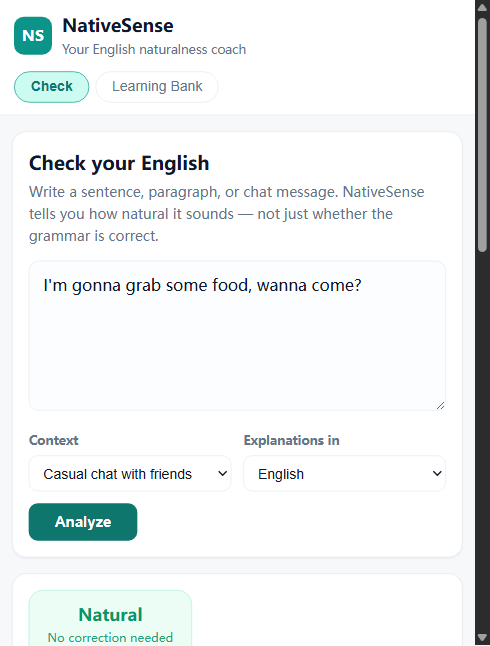
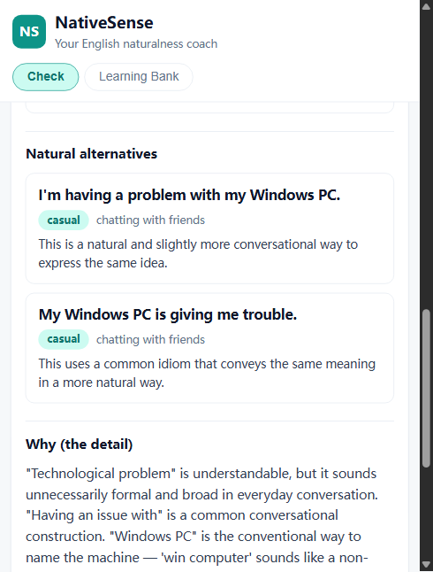
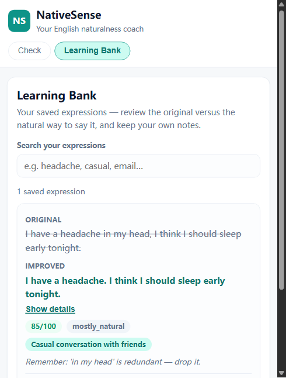

# NativeSense

**Your AI English Naturalness Coach.**

NativeSense is not another grammar checker. It helps non-native English speakers
understand whether their writing *sounds* natural, idiomatic, and appropriate
for the situation — the way fluent speakers actually communicate.

> “A grammatically correct sentence is not necessarily a natural one.”
> NativeSense is built around exactly that distinction.



---

## What it does

NativeSense follows one rule: **evaluate first, correct only when necessary,
explain in depth.** It never assumes every sentence needs fixing — if your
expression is already natural and fits its context, it says so and explains why
it works.

| Feature | Description |
| --- | --- |
| **Naturalness Check** | Paste a sentence, paragraph, or chat message and get a **four-level naturalness verdict** — Natural, Mostly Natural, Understandable but Awkward, or Unnatural — plus a grammar status and a plain-language assessment. No arbitrary 0–100 scores. |
| **Natural Alternatives** | When there is real room for improvement, NativeSense offers 2–4 alternative phrasings with their tone, suitable contexts, and the nuance of each. If your sentence is already natural, it says so and provides no unnecessary rewrites. |
| **Detailed Explanations** | A dedicated “Why” section explains *why* something sounds off, which words or constructions cause it, and why the suggested version works better — with a “takeaway” you can remember next time. Your meaning and personality are preserved. |
| **Context-Aware Analysis** | Choose a context (casual chat, online discussion, academic writing, professional email, social media…) and the AI evaluates your expression against it, with regional notes when usage differs by English variety. |
| **Personal Learning Bank** | Save analyses — original vs. improved, explanations, vocabulary — then search, edit notes, and delete entries anytime. |

Explanations can be shown in **English** or **Chinese** (中文).

Every analysis runs through a fixed six-step pipeline: understand the intended
meaning → check grammar → judge naturalness → pinpoint issues → suggest
alternatives when warranted → explain the reasoning.





## How it works

NativeSense is a small TypeScript full-stack app in two npm workspaces:

```
┌─────────────────────┐     HTTP /api     ┌──────────────────────────────┐
│  web (React + Vite) │ ────────────────▶ │  server (Express + TypeScript)│
│  Check page         │  ◀─────────────── │  /api/analyze   — AI analysis │
│  Learning Bank      │   JSON responses  │  /api/entries  — learning bank│
└─────────────────────┘                   └──────────────┬───────────────┘
                                                         │
                          ┌──────────────────────────────┼──────────────────┐
                          │                              │                  │
              ┌───────────▼───────────┐      ┌───────────▼───────────┐      │
              │  AI layer             │      │  Storage layer        │      │
              │  prompts.ts (coach)   │      │  JSON file store      │      │
              │  provider.ts (Ollama) │      │  (server/data/)       │      │
              │  analysisService.ts   │      │  atomic writes,       │      │
              └───────────┬───────────┘      │  searchable           │      │
                          │                  └───────────────────────┘      │
                 ┌────────▼────────┐                                        │
                 │ Local model     │  e.g. Ollama + qwen2.5:7b (default)    │
                 │ or any OpenAI-  │  or any OpenAI-compatible cloud API    │
                 │ compatible API  │  (swap via .env, no code changes)      │
                 └─────────────────┘                                        │
```

- **AI analysis logic is isolated** in `server/src/ai/`: a coach-style system
  prompt that enforces the six-step pipeline and four-level naturalness verdict,
  with few-shot examples and a validation/normalization layer that tolerates
  small-model sloppiness.
- **API keys never leave the server.** The web app talks only to your own
  backend. Cloud keys live in `.env`, which is git-ignored.
- **Storage is a plain JSON file** by design, so the MVP needs no database.
  The repository interface (`LearningBankRepository`) is ready to be backed by
  SQLite or Postgres later without touching routes or the frontend.

## Tech stack

- **Frontend:** React 19 + TypeScript + Vite (no UI framework — clean, minimal CSS)
- **Backend:** Node.js + Express 5 + TypeScript, Zod for input validation
- **Tests:** Vitest (43 tests: analysis pipeline, routes, storage, evaluation set)
- **AI:** Ollama (default, fully offline) or any OpenAI-compatible endpoint

## Prerequisites

- **Node.js 20+** (developed on Node 22)
- **Ollama** with a model, e.g. `qwen2.5:7b` (default). Any reasonably capable
  model works; smaller 7B models may occasionally produce terse output, which
  the server sanitizes.

```bash
ollama pull qwen2.5:7b
```

## Installation & running

```bash
# 1. Install all workspace dependencies
npm install

# 2. Configure environment (copy the template)
cp .env.example .env
#    Defaults already point at local Ollama — for most setups you're done.

# 3. Start API (:3001) and web (:5173) together
npm run dev
```

Open **http://localhost:5173**, type a sentence, pick a context, and hit
**Analyze**.

### Using a cloud model instead

Edit `.env`:

```dotenv
AI_PROVIDER=openai
AI_MODEL=gpt-4o-mini
OPENAI_API_KEY=sk-...
# optional: OPENAI_BASE_URL=https://api.openai.com/v1
```

`AI_PROVIDER=ollama` and `AI_PROVIDER=openai` use the exact same provider
interface — no code changes.

## Environment variables

| Variable | Default | Purpose |
| --- | --- | --- |
| `PORT` | `3001` | Backend port |
| `AI_PROVIDER` | `ollama` | `ollama` or `openai` |
| `AI_MODEL` | `qwen2.5:7b` | Model name sent to the provider |
| `OLLAMA_BASE_URL` | `http://localhost:11434/v1` | Ollama's OpenAI-compatible endpoint |
| `OPENAI_API_KEY` | *(empty)* | Cloud key — **never commit it** |
| `OPENAI_BASE_URL` | `https://api.openai.com/v1` | Any OpenAI-compatible base URL |
| `DATA_DIR` | `server/data` | Where the learning bank JSON lives |

## Testing & quality

```bash
npm test            # server unit/integration tests (Vitest, 43 tests)
npm run typecheck   # TypeScript check across both packages
npm run lint -w web # frontend lint (oxlint)
npm run build -w web
```

## Evaluation

NativeSense ships with a linguistic evaluation harness that runs real model
inference against a curated dataset and reports how consistently the model
recognizes when **no correction is needed** — the quality bar that matters most
for a naturalness coach.

- **Dataset:** `server/test/fixtures/evaluation-set.ts` — 35 sentences across 7
  categories: already-natural, awkward-but-correct, genuine grammar errors,
  slang/internet English, formal/academic, regional differences, and
  sarcasm/irony. Each case carries expected labels for `no_correction_needed`,
  `naturalness`, and `grammar_status`.
- **Runner:** `server/src/eval/runEvaluation.ts` — calls the real analysis
  service, writes a JSON report to `server/eval/results/`, and prints agreement
  rates. Supports `--limit`, `--ids`, and `--categories`.

```bash
npm run eval                # full 35-sentence run (needs Ollama + model)
npm run eval -w server -- --limit 10   # quick smoke run
```

**Current status (first 10 sentences, qwen2.5:7b):** the model correctly
declares *no correction needed* for all 5 already-natural sentences and for 3 of
5 awkward-but-correct ones (60% → 80% across three prompt iterations). The two
remaining misses — “Let’s do a meeting” and “My English level is very poor” —
are a known limitation of the 7B model (it treats meaningfully-translated
Chinese collocations as natural English), not a prompt issue. See
[`docs/EVALUATION-REPORT.md`](docs/EVALUATION-REPORT.md) for the per-sentence
review, the iteration history, and upgrade suggestions.

## Project structure

```
new-chat/
├─ package.json            # npm workspaces root (server + web)
├─ server/
│  ├─ src/
│  │  ├─ ai/               # prompts, provider, analysis service, schema
│  │  ├─ eval/             # evaluation runner (real-model inference)
│  │  ├─ routes/           # /api/analyze, /api/entries (full CRUD)
│  │  ├─ storage/          # atomic JSON store + learning bank repository
│  │  ├─ app.ts            # Express app with dependency injection
│  │  └─ config.ts         # typed environment config
│  ├─ test/
│  │  └─ fixtures/         # 35-sentence evaluation dataset
│  └─ eval/results/        # generated evaluation reports (JSON)
├─ web/
│  └─ src/
│     ├─ pages/            # CheckPage, BankPage
│     ├─ api/client.ts     # typed API wrapper
│     └─ types.ts          # mirrors the server contract
└─ docs/screenshots/       # README screenshots
```

## API overview

- `POST /api/analyze` — `{ text, context?, explanationLanguage }` → `{ analysis }`
- `GET  /api/entries?q=` — list / search saved entries
- `POST /api/entries` — save an entry
- `PATCH /api/entries/:id` — update (e.g. notes)
- `DELETE /api/entries/:id` — delete an entry

### Analysis response shape (v2)

```ts
{
  naturalness: "natural" | "mostly_natural" | "awkward" | "unnatural",
  grammar_status: "correct" | "minor_errors" | "incorrect",
  issues: [{ original_segment, issue_type, severity?, explanation }],
  recommended_expression: string | null,
  alternatives: [{ expression, tone, context, nuance }],
  detailed_explanation: string,
  regional_notes?: string,
  learning_takeaway: string,
  no_correction_needed: boolean
}
```

There is **no numeric score** anywhere in the API. When
`no_correction_needed` is true, `issues` is empty, `recommended_expression` is
null, and alternatives are omitted or optional stylistic variations.

## Known limitations

- **Output quality follows the local model.** With a 7B model you may see
  occasional short or uneven answers; the server validates, sanitizes, and
  retries once, but larger models (e.g. `qwen2.5:14b` or a cloud model)
  produce noticeably richer coaching. The evaluation run confirms the 7B model
  has blind spots for Chinese-mother-tongue collocations like “do a meeting” —
  a model-capability boundary, not a prompt fix.
- **Evaluation covers 10 of 35 sentences so far.** The full 35-sentence run is
  supported (`npm run eval`) but was deliberately deferred until a stronger
  model is configured.
- **Local-first storage:** data lives in `server/data/entries.json` on your
  machine. No auth, no cloud sync yet — the repository layer is designed so a
  real database can be added later.
- **Single user:** there is no login; the learning bank is one shared local
  store.
- **Language scope:** input is English (with English/Chinese explanations).
  The provider interface is language-agnostic, but other source/target
  languages are future work.

## Roadmap

- Run the full 35-sentence evaluation with a stronger model and expand the set
- SQLite/Postgres persistence and user accounts
- More explanation languages
- Learning-bank export/import (CSV/JSON)
- Streaks and spaced-repetition review for saved expressions

## Contributing

Contributions are welcome! Please keep changes small, add tests for new
behavior, and make sure `npm test` and `npm run typecheck` pass before
opening a PR.

## License

[MIT](LICENSE)
